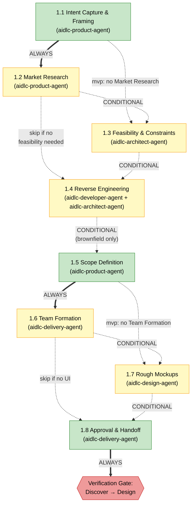
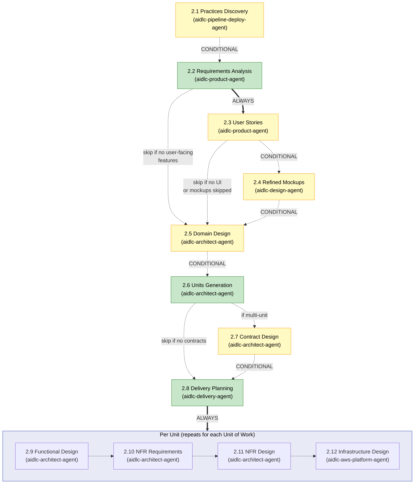
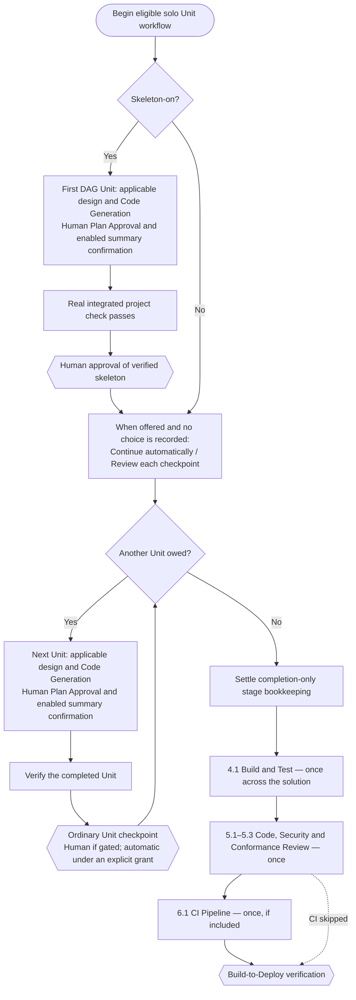
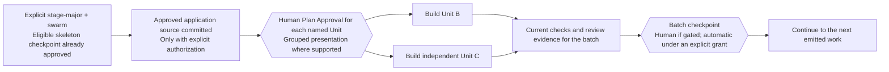
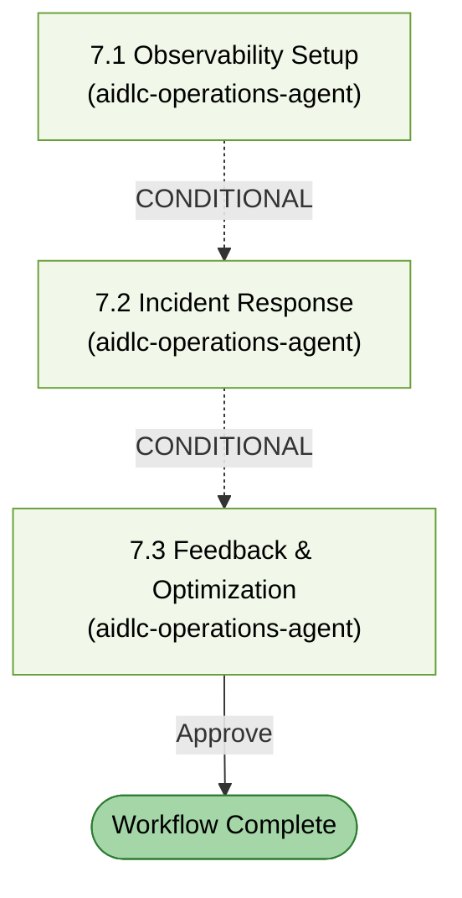

# Phases and Stages

The AI-DLC lifecycle is organized into seven phases (Discover, Design, Build, Test, Secure, Deploy, Operate) containing 33 stages, after three hidden Initialization stages. This chapter explains each phase, lists its stages, and shows how they connect.

> **Harness note.** The methodology — the phases, stages, agents, and gates this
> guide describes — is identical on every harness. Where a mechanic differs by
> harness (how a gate renders, how a subagent is dispatched, where config lives),
> the difference is called out and tabled in your harness's chapter:
> [Running on other harnesses](harnesses/README.md). Examples here use Claude Code
> unless noted.

---

## Lifecycle Overview

```mermaid
graph LR
    subgraph INITIALIZATION["INITIALIZATION (0.1-0.3)"]
        Z1["Workspace Scaffold"]
        Z4["State Initialization"]
        Z1 -.->|"3 stages"| Z4
    end

    subgraph DISCOVER["DISCOVER (1.1-1.8)"]
        I1["Intent Capture"]
        I8["Approval & Handoff"]
        I1 -.->|"8 stages"| I8
    end

    subgraph DESIGN["DESIGN (2.1-2.12)"]
        D1["Practices Discovery"]
        D12["Infrastructure Design"]
        D1 -.->|"12 stages"| D12
    end

    subgraph BUILD["BUILD (3.1)"]
        B1["Code Generation"]
    end

    subgraph TEST["TEST (4.1-4.2)"]
        T1["Build and Test"]
        T2["Performance Validation"]
        T1 -.->|"2 stages"| T2
    end

    subgraph SECURE["SECURE (5.1-5.3)"]
        S1["Code Review"]
        S3["Conformance Review"]
        S1 -.->|"3 stages"| S3
    end

    subgraph DEPLOY["DEPLOY (6.1-6.4)"]
        P1["CI Pipeline"]
        P4["Deployment Execution"]
        P1 -.->|"4 stages"| P4
    end

    subgraph OPERATE["OPERATE (7.1-7.3)"]
        O1["Observability Setup"]
        O3["Feedback & Optimization"]
        O1 -.->|"3 stages"| O3
    end

    Z4 -->|"auto-proceed"| I1
    I8 -->|"Verification Gate 1"| D1
    D12 -->|"Verification Gate 2"| B1
    B1 --> T1
    T2 --> S1
    S3 -->|"Verification Gate 3"| P1
    P4 --> O1
    O3 -.->|"Feedback Loop"| I1

    style INITIALIZATION fill:#f3e5f5,stroke:#9c27b0,color:#000
    style DISCOVER fill:#e8f5e9,stroke:#4caf50,color:#000
    style DESIGN fill:#e3f2fd,stroke:#2196f3,color:#000
    style BUILD fill:#fff3e0,stroke:#ff9800,color:#000
    style TEST fill:#fff8e1,stroke:#ffb300,color:#000
    style SECURE fill:#efebe9,stroke:#6d4c41,color:#000
    style DEPLOY fill:#fce4ec,stroke:#e91e63,color:#000
    style OPERATE fill:#f1f8e9,stroke:#689f38,color:#000
```

<!-- Text fallback: Linear flow: INITIALIZATION (0.1-0.3) auto-proceeds to DISCOVER (1.1-1.8), which passes through Verification Gate 1 to DESIGN (2.1-2.12), through Verification Gate 2 to BUILD (3.1), then TEST (4.1-4.2), SECURE (5.1-5.3), through Verification Gate 3 to DEPLOY (6.1-6.4), and on to OPERATE (7.1-7.3). A feedback loop returns from 7.3 back to 1.1. -->

Phases execute sequentially. At each of the three phase boundaries that has a check (Discover → Design, Design → Build, Build → Deploy), a **verification gate** runs automated traceability checks to catch missing links, orphaned artifacts, or inconsistencies before downstream stages build on them.

### What runs in order, and what runs in parallel

**Stages run one at a time, in order.** When a stage completes, the engine moves to the next stage in lifecycle order that your scope runs and that is not already done or skipped (the Unit walk repeats its stages per Unit, as described below). Within one workflow, a later phase does not start while a stage in an earlier phase is still open.

- To move ahead anyway, jump: `/aidlc --stage <name>` or `/aidlc --phase <name>`. The stages you pass over are marked skipped (`[S]`); they are not run later on their own. Jumping back to an earlier stage reopens it and every later stage in your plan. The files stay; a reopened stage that finds its earlier files asks whether to keep them, modify them, or redo the stage from scratch. See [Skipping and Navigating Stages](07-interaction-modes.md#skipping-and-navigating-stages).
- To run one stage without moving your workflow, use `/aidlc --stage <name> --single`. It writes that stage's artifact and stops with no workflow gate; your workflow stays where it was. When your work already holds files for that stage, it keeps a copy of them in the record's `archive/` folder first, and one line says where.

**The Unit walk repeats its stages for each Unit.** The per-Unit stages are Functional Design (2.9), NFR Requirements (2.10), NFR Design (2.11), Infrastructure Design (2.12) and Code Generation (3.1). They run in one of two walks:

- **Unit-major** (the default for new solo work that has Units and produces source): one Unit goes through its design stages and Code Generation, then the next Unit starts again at the first design stage. You approve each Unit at a verified Unit checkpoint; your team's blocking checks run on that Unit's own files at its checkpoint, so a check that fails is put to you there (fix it, or override it for that Unit), before the next Unit is built on it, and is not checked again at the end while that file and the check's settings stay as they were. The stage gates that follow the last Unit are recorded as bookkeeping. Workflows without Unit checkpoints, such as older ones, get one question for those stage approvals instead: one Approve approves them all, and a change request approves none of them. A change for one Unit's stage ("in beta's NFR design, retry failed calls through a queue") redoes that stage and the ones after it for that Unit only, from your words; the other Units are asked nothing, and the one question comes back once. See [Why the Unit walk works the way it does](#why-the-unit-walk-works-the-way-it-does).
- **Stage-major**: every Unit goes through one stage before the next stage starts, and that stage's gate comes once, after the last Unit. With a walking skeleton on, the first Unit still goes through every stage, including Code Generation, before the other Units start.

**What can run in parallel**, within a stage or across Units in the Unit walk:

- **Units in the Unit walk.** On a stage-major walk with `Construction Execution: swarm`, Units whose dependencies are done build together in one batch, then share one batch checkpoint. Unit-major stays serial. See [Parallel Unit batches](#parallel-unit-batches).
- **Per-Unit design passes.** On a stage-major walk, the design stages can hand you a wave of Units that do not depend on each other. Each Unit's questions are asked in your chat first, one Unit after another; then the Units are designed side by side from your answers.
- **People, in team mode.** With `Unit Ownership: team`, each person claims a Unit and builds it in their own checkout at the same time as the others. Each checkout keeps its own place, so two people can be at different stages at once. A claim is refused until that Unit's dependencies, and any required walking skeleton, are complete.
- **Agents within a stage.** User Stories (2.3) is a mob: the design, developer, and quality agents contribute at the same time. Practices Discovery (2.1) has its inspectors look at the draft independently. Agents and design waves run at the same time where the harness can dispatch in parallel; on a harness that cannot, they run one after another with the same briefs. See [Stage Execution Modes Reference](#stage-execution-modes-reference).

**Which stops you always get, and what settings change.**

- Every stage your scope runs, outside Initialization, ends with an approval gate. Your scope decides which stages run; a stage it skips has no gate. In the Unit walk, the walk above decides whether you approve per Unit or per stage. In team mode, the gate rhythm you choose when claiming (`per-stage` or `unit-end`) sets the review points instead. See [Multi-Team Construction](workshop-mode.md).
- During the Unit walk, choosing **Continue automatically** waives the ordinary completion checkpoints. You still get Plan Approval (unless plan approval is off for the work), an enabled summary confirmation, the verification command choice, skeleton approval, and every failure.
- The ceremony switches remove only what they name: sensors, learnings, the summary confirmation, plan approval, and collaborators (the support agents a stage brings in). See [Ceremony Switches](13-customization.md#ceremony-switches). Guard Policy changes how hard the guards hold, not which gates you see.
- A gate that is put to you needs a real message from you to approve it. Nothing in a scope, a per-work setting, or Guard Policy lowers that; only `AIDLC_SKIP_HUMAN_PRESENCE_GUARD=1` does, set machine-wide or recorded with `aidlc config flags --bypass`, and AI-DLC tells you while it is off. Checkpoints you chose to let run automatically are recorded without asking you.

**How later stages depend on earlier ones.** Each stage declares the artifacts it reads (`consumes`) and writes (`produces`). The engine hands a stage the paths it needs. When a required input is missing, the stage is told whether that is expected (the stage that makes it is not in your scope) or a real gap (for example a stage you skipped with a jump). An expected gap means the stage works from what exists instead of inventing the file. A real gap is raised with you, so you can run the stage that makes the file or put the file in place yourself. The verification gate at each phase boundary checks that the links between phases hold.

---

## Phase 0: Initialization

**Purpose:** Bootstrap the workspace: create the intent's record dir, detect the workspace, and initialize state. The welcome message is shown at session start via the `companyAnnouncements` entry in `settings.json` (not a stage).

Initialization stages run **automatically** without approval gates. All three execute inside a single deterministic tool call (`aidlc-utility intent-create`) that completes in well under a second.

| # | Stage | Lead | Key Artifacts | Condition |
|---|-------|------|---------------|-----------|
| 0.1 | Workspace Scaffold | orchestrator | first intent's record dir (`aidlc/spaces/<space>/intents/<YYMMDD>-<label>/`) | ALWAYS |
| 0.2 | Workspace Detection | orchestrator | `aidlc-state.md` (workspace state) | ALWAYS |
| 0.3 | State Initialization | orchestrator | `aidlc-state.md`, `audit/` shards | ALWAYS |

**Execution notes:**
- All three stages run inline inside `aidlc-utility intent-create` - no LLM subagent delegation, no per-stage prompt.
- Workspace detection is a rule-based scanner (file extensions, known config filenames, package manifests).
- No user interaction is needed during this phase.

---

## Phase 1: Discover

**Purpose:** Validate the initiative — capture intent, assess feasibility, understand existing code on brownfield work, define scope, form the team, and secure approval to proceed.

<!-- Text fallback: 1.1 Intent Capture (ALWAYS) flows to 1.2 Market Research (CONDITIONAL); mvp goes from 1.1 to 1.3. 1.2 flows to 1.3 Feasibility (CONDITIONAL) or to 1.4. 1.3 flows to 1.4 Reverse Engineering (CONDITIONAL, brownfield only). 1.4 flows to 1.5 Scope Definition (ALWAYS). 1.5 flows to 1.6 Team Formation (CONDITIONAL); mvp goes from 1.5 to 1.7. 1.6 flows to 1.7 Rough Mockups (CONDITIONAL, skip if no UI) or to 1.8. 1.7 flows to 1.8 Approval & Handoff (ALWAYS), then Verification Gate 1. poc goes from 1.1 to 1.4 and leaves Discover after 1.4. -->

| # | Stage | Lead | Supporting | Key Artifacts | Condition |
|---|-------|------|-----------|---------------|-----------|
| 1.1 | Intent Capture & Framing | aidlc-product-agent | aidlc-architect-agent | Intent statement, stakeholder map | ALWAYS |
| 1.2 | Market Research | aidlc-product-agent | — | Competitive analysis, build-vs-buy | CONDITIONAL |
| 1.3 | Feasibility & Constraints | aidlc-architect-agent | aidlc-aws-platform-agent, aidlc-compliance-agent | Feasibility assessment, constraint register, RAID log | CONDITIONAL |
| 1.4 | Reverse Engineering | aidlc-developer-agent | aidlc-architect-agent | 9 RE artifacts | Brownfield projects |
| 1.5 | Scope Definition | aidlc-product-agent | aidlc-delivery-agent | Scope definition, intent backlog | ALWAYS |
| 1.6 | Team Formation | aidlc-delivery-agent | — | Team assessment, mob composition plan | CONDITIONAL |
| 1.7 | Rough Mockups | aidlc-design-agent | aidlc-product-agent | Wireframes, user flows | CONDITIONAL |
| 1.8 | Approval & Handoff | aidlc-delivery-agent | aidlc-product-agent | Initiative brief, decision log | ALWAYS |

Which plans enter Discover, and which stages each runs: `enterprise` and `feature` run all eight stages; `mvp` runs Intent Capture, Feasibility & Constraints, Reverse Engineering, Scope Definition and Rough Mockups; `poc` runs Intent Capture and Reverse Engineering; `infra` runs none of them; and `bugfix`, `classic`, `express`, `refactor`, `security-patch` and `workshop` run Reverse Engineering only.

**Key behavior:** Stage 1.4 runs as a **pipeline**: with collaborators on, a 2-link chain (first an aidlc-developer-agent code scan, then an aidlc-architect-agent synthesis that writes the artifacts); with collaborators off, the developer alone scans and writes them. Each return creates an ordered durable receipt, and multi-repo work requires one complete chain per repo before approval. It only executes for brownfield projects.

**Stage colors:** Green = ALWAYS (runs whenever the selected scope includes it). Yellow = CONDITIONAL (may skip based on scope, project type, or plan). For the exact per-scope stage membership, see the [Stage-by-Scope Matrix](05-scopes-and-depth.md#stage-by-scope-matrix).

Intent Capture records the initial description, workflow-selected scope, and
used memory rules in its questions file. Claims in the intent statement and
stakeholder map carry inline source tags; both artifacts surface assumptions
and open questions. Retained assumptions require explicit confirmation before
the Product Lead reviewer and approval gate run.

---

## Phase 2: Design

**Purpose:** Elaborate the requirements and the design — discover team practices, elicit requirements, design the architecture, decompose into units of work, plan delivery, and design each Unit's functional, NFR and infrastructure details.

<!-- Text fallback: 2.1 Practices Discovery (CONDITIONAL) runs as a hub-and-spoke on every included scope (lead draft, mutually blind quality/developer/devsecops spokes, human interview, lead integration) and promotes affirmed work to active-space memory. Next are 2.2 Requirements Analysis (ALWAYS), optional 2.3 User Stories mob, optional 2.4 Refined Mockups, optional 2.5 Domain Design, 2.6 Units Generation (ALWAYS), optional 2.7 Contract Design, and 2.8 Delivery Planning (ALWAYS). Delivery Planning writes the Design → Build check. Then the per-Unit stages 2.9 Functional Design, 2.10 NFR Requirements, 2.11 NFR Design and 2.12 Infrastructure Design run for each Unit, each CONDITIONAL. -->

Supporting agents take part when collaborators are on (the `collaborators` setting, shipped on only for `enterprise`; `/aidlc --collaborators on` turns it on for one piece of work); otherwise each stage runs with its lead agent only.

| # | Stage | Lead | Supporting | Key Artifacts | Condition |
|---|-------|------|-----------|---------------|-----------|
| 2.1 | Practices Discovery | aidlc-pipeline-deploy-agent | aidlc-quality-agent, aidlc-developer-agent, aidlc-devsecops-agent | `team-practices.md`, `discovered-rules.md`, `evidence.md` (promoted to `aidlc/spaces/<active-space>/memory/team.md` / `project.md` on affirmation) | CONDITIONAL |
| 2.2 | Requirements Analysis | aidlc-product-agent | — | `requirements.md` | ALWAYS |
| 2.3 | User Stories | aidlc-product-agent | aidlc-design-agent, aidlc-developer-agent, aidlc-quality-agent | `stories.md`, `personas.md` | User-facing features |
| 2.4 | Refined Mockups | aidlc-design-agent | aidlc-product-agent | Hi-fi mockups, interaction spec | UI projects |
| 2.5 | Domain Design | aidlc-architect-agent | aidlc-aws-platform-agent, aidlc-design-agent | `components.md`, `decisions.md` (ADRs) | Per execution plan |
| 2.6 | Units Generation | aidlc-architect-agent | aidlc-delivery-agent | `unit-of-work.md`, `unit-of-work-dependency.md` (DAG), `unit-of-work-story-map.md` | ALWAYS |
| 2.7 | Contract Design | aidlc-architect-agent | aidlc-aws-platform-agent | `contract-summary.md` | CONDITIONAL |
| 2.8 | Delivery Planning | aidlc-delivery-agent | aidlc-architect-agent | `bolt-plan.md`, `team-allocation.md`, `risk-and-sequencing-rationale.md`, `external-dependency-map.md` | ALWAYS |
| 2.9 | Functional Design | aidlc-architect-agent | aidlc-developer-agent | `entities.md`, `rules.md`, `functional-spec.md` | Per Unit (CONDITIONAL by execution plan) |
| 2.10 | NFR Requirements | aidlc-architect-agent | aidlc-devsecops-agent, aidlc-compliance-agent, aidlc-quality-agent | Performance, security, scalability, reliability, observability NFRs | Per Unit (CONDITIONAL) |
| 2.11 | NFR Design | aidlc-architect-agent | aidlc-aws-platform-agent | NFR design specifications | Per Unit (CONDITIONAL) |
| 2.12 | Infrastructure Design | aidlc-aws-platform-agent | aidlc-devsecops-agent, aidlc-compliance-agent | Infrastructure specifications, IaC designs | Per Unit (CONDITIONAL) |

**Key behavior:** Stage 2.1 runs as a **subagent hub-and-spoke** on greenfield and brownfield work: the lead drafts, quality/developer/devsecops inspect it independently, the human interview resolves gaps, and the lead integrates. Stage 2.3 runs as a **mob**: the lead drafts, and the design, developer, and quality agents contribute in parallel via contribution files. Delivery Planning (2.8) writes the Design → Build check, `verification/phase-check-design.md`, and the per-Unit stages 2.9–2.12 follow it for each Unit.

---

## Phase 3: Build

**Purpose:** Write the code for each Unit of Work, in reviewable slices. The per-Unit design stages come before it in Phase 2; Build and Test, and the phases after it, run once across all Units.

### Why the Unit walk works the way it does

New solo workflows that include Unit decomposition and a source-producing
Code Generation stage default to **unit-major, serial execution with verified Unit
checkpoints**. Each Unit completes its applicable design stages and Code
Generation before the next. Runtime order follows `unit-of-work-dependency.md`;
`bolt-plan.md` records delivery grouping and rationale without replacing that DAG.

With skeleton-on, the first DAG Unit is the smallest working integrated slice.
Its code must run through a real end-to-end check, and you approve the verified
skeleton before later Units begin. This happens even if you explicitly choose
stage-major order. A first design-stage review alone is not a working skeleton.

The check is the intent's recorded, human-authorized `Construction Verification
Command`, reused for every Unit/batch checkpoint. Delivery Planning proposes it
from the project scan and asks you to approve it. Your approval of that question,
in your own words or by picking **Approve**, is what sets it, in the chat that
asked or in a new one while it is the newest question asked; **Request
Changes** or an answer to some other question does not. You may
defer if no runnable check exists yet; the first checkpoint then asks before
verification (on Kiro IDE and Kiro CLI v3, a side-by-side build asks once its plans
are approved, before its workers start). A missing authorization or later command change always requires
the [recorded-command flow](12-cli-commands.md#construction-verification-command-record-human-authorization),
never a command chosen at verify time. The approval question shows **Verified
with `<verification_command>` (exit 0)**.
The verifier records a tool-owned `CHECKPOINT_VERIFICATION_RECORDED` receipt
alongside the proof file, and approval requires that receipt; a hand-written
proof file cannot verify a Unit. On a checkout with no proof file at all (a
fresh clone, another machine), that receipt stands in for the proof of a Unit
already approved whose evidence is unchanged, so nothing runs again.

At a Unit or skeleton checkpoint you are asked to **Approve** or **Request
Changes**. Answer in your own words or pick an option: your reply to that
checkpoint's question decides it, in the chat that asked or in a new one while
it is the newest question asked, and an option you pick is the one recorded.
A reply to a different question does not count. A checkpoint whose work changed after it was asked is asked again. Checkpoints
you chose to let run automatically are recorded without a question.

The autonomy offer is **Continue automatically** / **Review each checkpoint**:
for eligible checkpoint workflows, skeleton-off offers it at the start of the Unit walk,
and skeleton-on offers it after the real skeleton checkpoint. An existing choice
is not repeated; on-demand grant/revoke requests remain available. Plan Approval,
enabled summary confirmation, verification command selection, and failures still
need human attention under either choice. Summary confirmation applies only when
`directive.ceremony.summary_confirmation === "on"`.

The new default does not convert existing workflows, design-only work, or flows
without Units. Their existing stage approvals remain. Team-owned Units keep their
own per-stage or unit-end gate rhythm. Preserve explicit iteration choices.

### Unit walk flow

This diagram shows the default path for an eligible solo workflow that produces
source. Other workflows keep their recorded execution and approval policy.

<!-- Text fallback: An eligible solo source-producing workflow completes and verifies the first integrated Unit with human skeleton approval when skeleton-on. When offered, choose Continue automatically or Review each checkpoint unless a choice already exists. Complete remaining Units serially with human Plan Approval and any enabled summary confirmation, verify each, and approve ordinary checkpoints according to the recorded policy. Completion-only stage gates are bookkeeping; Build and Test (4.1), the Secure reviews (5.1-5.3) and optional CI Pipeline (6.1) run once across the solution. -->

### Parallel Unit batches

Unit-major remains serial. To use swarm execution in an eligible checkpoint
workflow, explicitly choose stage-major and `Construction Execution: swarm`:
say so in your own words, for example "run the Units in parallel", and AI-DLC
makes the changes this needs and says each in one line.
Execution and approval are separate choices: batch completion may be guided or
automatic. Dependency-ready Units may run together; an inline Unit already
approved at its checkpoint is not rebuilt in a later batch.
Before initial protected prepare, the approved parent application source must
be committed and reproducible. In particular, commit the approved inline
skeleton source before preparing parallel Units. This is an explicit action;
the tool never commits automatically and checks all Units before creating any
child. See [Swarm prepare](12-cli-commands.md#aidlc-engine-swarm-prepare-prepare-a-reproducible-batch).

A guided batch ends with one **Approve** / **Request Changes** question for the
batch, read the same way: your reply to that batch's question decides it.
Automatic batch approval asks nothing.

<!-- Text fallback: After explicit stage-major/swarm selection and any required skeleton approval, ensure the approved application source is committed with explicit authorization, then obtain Plan Approval for the exact emitted Units. Build dependency-independent Units in parallel, collect current verification and review evidence, then resolve that batch's guided or automatic checkpoint before the next work. -->

Design stages can use an emitted per-Unit wave on a stage-major path. The
conductor follows the emitted Unit set rather than deriving parallelism from a
Bolt-plan grouping. `BOLT_STARTED` / `BOLT_COMPLETED` apply to the swarm/worktree
path; serial inline Unit work uses its lifecycle and checkpoint receipts.

### Halt-and-ask on failure

Failures always stop the Unit walk, even in autonomous mode. The Build-and-Test loop-back's rung 4 also stops for the human; required Plan Approvals, summary confirmations, and verification command selection remain separate human decisions.

- If a solo Unit's Code Generation fails, the walk halts immediately and offers **retry** (re-run just that Unit), **skip** (mark it `[S]` and continue — dependents will likely also fail), or **abort**.
- If one Unit in a parallel batch fails while others succeed, the conductor waits for the whole batch to finish, preserves the successful Units' artifacts on disk, and presents the same retry / skip / abort choice for the failed Unit only.

### Stage reference

| # | Stage | Lead | Supporting | Key Artifacts | Runs |
|---|-------|------|-----------|---------------|------|
| 3.1 | Code Generation | aidlc-developer-agent | — | Application code + code docs | Per Unit (ALWAYS) |

**Key behaviors:**

- Eligible new source-producing solo Unit workflows default to unit-major and serial execution. Legacy, design-only, no-Unit, and team-owned workflows retain their existing paths.
- The real skeleton is the first complete integrated Unit, verified and human-approved before later Units; a legacy first-stage gate is only a stage review.
- Ordinary completion follows the recorded autonomy policy. `completion_only` stage directives settle existing approvals without repeating bodies, reviewers, or human completion questions.
- An autonomy answer does not choose swarm or change iteration order. Explicit stage-major/swarm selection supports guided or automatic batch checkpoints.
- While Plan Approval is on for the work, each Unit's plan is approved; grouping its presentation never removes individual approval receipts. Enabled summary confirmation, verification command selection, and failures still require the human.
- Build and Test (4.1) reads every Unit's code. When Code Generation has not finished for some Units (a jump ahead skipped it, say), it says which in one line, with its gate or with your approval when you approve before the gate is shown (also when you ask to stop for now): "Code Generation has not finished for units beta and gamma, so their code may be missing from Build and Test." It never stops the approval.

---

## Phase 4: Test

**Purpose:** Prove the built solution works: build it, run its tests, and validate performance where the plan asks for it.

| # | Stage | Lead | Supporting | Key Artifacts | Condition |
|---|-------|------|-----------|---------------|-----------|
| 4.1 | Build and Test | aidlc-quality-agent | aidlc-devsecops-agent | Test results, quality report | ALWAYS, once across the solution |
| 4.2 | Performance Validation | aidlc-quality-agent | — | Load test results, NFR validation matrix | CONDITIONAL |

**Key behaviors:**
- Build and Test (4.1) runs once, after all Units, and reads every Unit's code.
- Performance Validation (4.2) runs in the scopes that include it (`enterprise`, `feature`, `workshop`).

---

## Phase 5: Secure

**Purpose:** Review the built code for quality, security, and conformance before it is deployed.

| # | Stage | Lead | Supporting | Key Artifacts | Condition |
|---|-------|------|-----------|---------------|-----------|
| 5.1 | Code Review | aidlc-quality-agent | — | Code review report, findings | ALWAYS |
| 5.2 | Security Review | aidlc-devsecops-agent | — | Security review report, findings | ALWAYS |
| 5.3 | Conformance Review | aidlc-compliance-agent | — | Conformance report | CONDITIONAL |

**Key behaviors:**
- Code Review (5.1) and Security Review (5.2) run in every scope that includes the Secure phase; Conformance Review (5.3) runs only where the plan includes it.

---

## Phase 6: Deploy

**Purpose:** Ship the solution — set up CI, the deployment pipeline and environments, and run the deployment.

| # | Stage | Lead | Supporting | Key Artifacts | Condition |
|---|-------|------|-----------|---------------|-----------|
| 6.1 | CI Pipeline | aidlc-pipeline-deploy-agent | — | CI config, quality gates | CONDITIONAL, once |
| 6.2 | Deployment Pipeline | aidlc-pipeline-deploy-agent | — | CD config, deployment strategy, rollback runbook | CONDITIONAL |
| 6.3 | Environment Provisioning | aidlc-aws-platform-agent | aidlc-devsecops-agent, aidlc-compliance-agent | Environment inventory, validation report | CONDITIONAL |
| 6.4 | Deployment Execution | aidlc-pipeline-deploy-agent | aidlc-developer-agent | Deployment log, smoke tests, health checks | CONDITIONAL |

**Key behaviors:**
- CI Pipeline (6.1) writes the Build → Deploy check, `verification/phase-check-build.md`, when the plan includes it. A plan that skips 6.1 gets no check at that boundary.
- Every Deploy stage is CONDITIONAL. `classic` and `poc` have no Deploy stage; `mvp` runs CI Pipeline only; `bugfix`, `express`, `refactor` and `security-patch` run Deployment Pipeline and Deployment Execution.

---

## Phase 7: Operate

**Purpose:** Operate the deployed solution — configure observability, respond to incidents, and feed what you learn back into the next Discover cycle.

<!-- Text fallback: All Operate stages are CONDITIONAL. 7.1 through 7.3 flow sequentially. On approval of Stage 7.3 the workflow is complete. -->

| # | Stage | Lead | Supporting | Key Artifacts | Condition |
|---|-------|------|-----------|---------------|-----------|
| 7.1 | Observability Setup | aidlc-operations-agent | — | Dashboards, alarms, SLO config | CONDITIONAL |
| 7.2 | Incident Response | aidlc-operations-agent | — | SSM runbooks, incident plan, escalation matrix | CONDITIONAL |
| 7.3 | Feedback & Optimization | aidlc-operations-agent | aidlc-aws-platform-agent | SLO report, cost analysis, feedback loop doc | CONDITIONAL |

**Key behaviors:**
- All 3 stages are **conditional**; `bugfix`, `classic`, `mvp`, `poc`, `refactor` and `security-patch` run none of them
- Stage 7.3 is the **terminal stage** — on approval, the workflow is complete. Its feedback loop feeds insights back into the next Discover cycle when you choose to keep iterating.

---

## Phase Transitions and Verification Gates

At the three phase boundaries that have a check (Discover → Design, Design → Build, Build → Deploy), the framework runs **phase boundary verification**. The stage that writes each check is named in its phase above: Approval & Handoff (1.8), Delivery Planning (2.8), and CI Pipeline (6.1). This automated check validates:

- All required artifacts from the completing phase exist
- Traceability links between artifacts are intact (e.g., every requirement maps to a story)
- No orphaned artifacts or missing references
- Consistency between related artifacts

If verification fails, the conductor reports the issues and asks whether to proceed or go back to fix them.

---

## Stage Execution Modes Reference

| Mode | Stages | User Interaction | Description |
|------|--------|-----------------|-------------|
| Inline (auto-proceed) | 0.1, 0.2, 0.3 | None | Run deterministically inside `aidlc-utility intent-create`, no approval gate |
| Inline | 29 stages | Full | Agent works in conversation, approval gate at end |
| Subagent | 2.1, 3.1 | Practices interview + final gate for 2.1; approval gate for 3.1 | Hub-and-spoke Practices Discovery; focused Code Generation |
| Pipeline | 1.4 | Approval gate only | Developer scan, then architect synthesis-and-write (the developer alone with collaborators off) |
| Mob | 2.3 | Mid-stage judgment questions + approval gate | Lead drafts; design/developer/quality collaborate in parallel via contribution files |

Across the 33 runnable stages, the topology count is **29 inline / 2 subagent / 1 pipeline / 1 mob**; the three Initialization stages are also inline.

---

## Next Steps

- [Scopes, Depth, and Test Strategy](05-scopes-and-depth.md) — how scopes control which stages execute, including the full [Stage-by-Scope Matrix](05-scopes-and-depth.md#stage-by-scope-matrix)
- [Agents](06-agents.md) — the 14-agent roster and its domain, review, and composition roles
- [Your First Workflow](02-your-first-workflow.md) — annotated walkthrough
- [Glossary](glossary.md) — terminology reference
