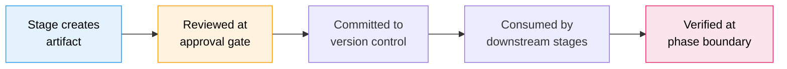

# Artifacts Reference

Every AI-DLC workflow produces artifacts under its **intent record dir** —
`aidlc/spaces/<space>/intents/<YYMMDD>-<label>/` (where `<space>` is `default`
unless a non-default space is in play, and `<YYMMDD>-<label>` is the intent dir;
written `<record>/` below). This chapter is a complete reference for the
directory structure, per-artifact descriptions, lifecycle, and git policy.

---

## Directory Tree

This is the complete set of places an artifact can land, not what a fresh record
looks like. Intent creation makes one folder per phase your scope runs (plus
`verification/`); the rest appear as work happens, and a per-stage folder is
created the first time that stage writes.

Framework files share one `.aidlc-engine/` directory beside the human artifacts.
After an upgrade, existing audit rows still verify reviews at their recorded
paths. Sensor findings and summary authorizations use their older directories
only while the corresponding new directory is absent. New writes use
`.aidlc-engine/`; other transient or derived files are recreated there.

```
aidlc/spaces/<space>/intents/<YYMMDD>-<label>/   # one record dir per intent
  aidlc-state.md                    # Workflow state (commit)
  project-description.json          # Your first request, exactly as given (commit)
  audit/                            # Audit trail — per-clone shards (commit)
    <host>-<clone>.md               # this clone's shard; readers glob + merge by timestamp
  .aidlc-engine/                    # Framework state (gitignore)
    sensors/                       # Advisory findings and type-check cache
    reviews/                       # Digest-bound review records and drafts
    summary-authorization/         # Active summary confirmations
    source-review/                 # Local reviewed-source snapshots
    hooks-health/                  # Hook heartbeats and drop counters
    plan.json                      # Derived scope plan
    state-writes.json              # Recent state writes, for doctor
    stop-hook/                     # No-progress guard counters
    human-turn                     # Last human prompt marker
    engine-touch                   # Last engine advance marker
    turn-end                       # Last step that ended the turn, until the person replies
    reviewer-dispatch.json         # Active per-unit reviewer scope
    document-input-path            # Document input handoff
    active-directive.json           # Transient execution cursor
    active-directive.lock/          # Cursor coordination
    guard-refusals/                 # Repeated refusal counters
    steering-token-key             # Local continuation signing key
    codekb-stage-<repo>/            # Temporary CodeKB candidates
  runtime-graph.json                # Execution telemetry view (gitignore)

  verification/                     # Phase boundary checks (commit)
    phase-check-discover.md         # written by Approval and Handoff
    phase-check-design.md           # written by Delivery Planning
    phase-check-build.md            # written by CI Pipeline

  initialization/                   # Phase 0: stays empty (state and audit only)

  discover/                         # Phase 1 artifacts
    intent-capture/
    market-research/                (conditional)
    feasibility/                    (conditional)
    scope-definition/
    team-formation/                 (conditional)
    rough-mockups/                  (conditional)
    approval-handoff/

  design/                           # Phase 2 artifacts
    practices-discovery/            (conditional)
    requirements-analysis/
    user-stories/                   (conditional)
    refined-mockups/                (conditional)
    domain-design/             (conditional)
    units-generation/
    contract-design/           (conditional)
    delivery-planning/
    {unit-name}/                    (per unit of work, repeated)
      functional-design/            (conditional)
      nfr-requirements/             (conditional)
      nfr-design/                   (conditional)
      infrastructure-design/        (conditional)

  build/                            # Phase 3 artifacts
    {unit-name}/                    (per unit of work, repeated)
      code-generation/

  test/                             # Phase 4 artifacts
    build-and-test/
    performance-validation/         (conditional)

  secure/                           # Phase 5 artifacts
    code-review/
    security-review/
    conformance-review/             (conditional)

  deploy/                           # Phase 6 artifacts
    ci-pipeline/                    (conditional)
    deployment-pipeline/            (conditional)
    environment-provisioning/       (conditional)
    deployment-execution/           (conditional)

  operate/                          # Phase 7 artifacts
    observability-setup/            (conditional)
    incident-response/              (conditional)
    feedback-optimization/          (conditional)

  archive/                          (created on-demand)
    {ISO-date}-{stage-name}/
```

Inside a stage folder are the stage's artifacts, its questions file, its
`memory.md` diary when learnings are on, and `reviews/review-NN.md`: a readable
copy of each review of the stage, numbered in the order the verdicts came. After
Intent Capture on the `mvp` plan, with Feasibility started, one record held
(captured, `.aidlc-engine/` left out):

```text
aidlc/spaces/default/intents/261013-inventory-api/
  aidlc-state.md
  project-description.json
  runtime-graph.json
  audit/
    <host>-<clone>.md
  build/
  deploy/
  design/
  discover/
    feasibility/
      feasibility-questions.md
      memory.md
    intent-capture/
      intent-capture-questions.md
      intent-statement.md
      memory.md
      reviews/
        review-01.md
      stakeholder-map.md
  initialization/
  secure/
  test/
  verification/
```

**The 9 reverse-engineering deliverables are not in the record dir.** They
(`architecture.md`, `code-structure.md`, `technology-stack.md`, …) land one
level up, in the space-level per-repo CodeKB —
`aidlc/spaces/<space>/codekb/<repo>/` — one store per repo rather than a copy
per intent. When the project folder is itself the repo, `<repo>` starts as the
folder's name (the main checkout's name in a linked git worktree), with each
character other than a letter, a digit, `.`, `_` or `-` made a hyphen (`portal app` is `portal-app`;
the folder keeps its name), and stays with the store: a moved, renamed or copied project folder keeps reading the same
store. The exception is a space holding two or more stores that no intent
records as its repo: there the current folder name is used, and the next step
can warn that completed stage results have drifted. On each applicable
brownfield intent, the stage checks the store's
recorded scope and working-tree fingerprint first. A verified-current store
whose coverage fits the intent may be reused by human choice; otherwise a full
rescan replaces those nine files, while a focused scan merges the newly
analyzed area into them and preserves prior prose outside it. Verified-current
coverage is accumulated as a union; stale or unverifiable prior deep coverage
is retained as prose and demoted to shallow
(`reverse-engineering-timestamp.md` records when the last scan ran and what
it covered). Pre-scan source/store generations and a locked all-artifact
publication prevent a source change from being mislabeled current and prevent
concurrent focused scans from silently replacing each other. Intents therefore
read the newest scan of the repo, not the one
taken when their own record dir was created. When the learnings ritual is on,
the record dir gets the stage's own `memory.md` diary — created by the engine
when it emits the run-stage directive (see **Per-stage memory diary** below) — so an
`discover/reverse-engineering/`
directory can appear there, holding the diary and nothing else. Codekb writes
are audit-logged with a `codekb > <repo> > <name>` breadcrumb, so the
per-intent trail still records what changed and when.

**Team knowledge is not in the record dir.** It lives one level up, at the space
level — `aidlc/spaces/<space>/knowledge/` (a sibling of `intents/`) — so it
accumulates across every intent in the space rather than being trapped in one
intent's record. The engine creates it empty; the team adds free-form files
under an optional `aidlc-shared/` and per-agent subdirectories. See
[Knowledge](08-knowledge.md).

**Per-stage memory diary.** When the learnings ritual is on, each executed stage
also keeps a committed `memory.md` alongside its artifacts (e.g.
`<record>/design/requirements-analysis/memory.md`). It is the
stage's observation diary — created by the engine from a template when it emits
the run-stage directive and maintained by the orchestrator during the stage, as
the stage's record of the agent's reasoning; nothing in it is offered to you as
something to keep. It is never hand-edited. See
[Rules and the Learning Loop](09-rules-and-the-learning-loop.md) for the
learning loop, which keeps the corrections you make.

**Code lives in sibling repos, not the record dir.** The `aidlc/` tree holds only
method, state, audit, and artifacts — never application code. Generated code lands
in the workspace's **code repos**: in the common single-repo case, the project dir
itself; in a multi-repo workspace, the sibling repo directories that are immediate
children of the workspace root (each with its own `.git`; a git submodule of a
project with code of its own is not one, so that project is the single-repo
case). An intent records the
repos it touches at creation - auto-discovered, or scoped with `--repos a,b` - in its
`intents.json` row (`repos: [...]`); the per-Unit walk anchors each git operation to one
of them. An intent with no recorded `repos` is the single-repo default. See
[CLI Commands](12-cli-commands.md).

---

## Artifact Lifecycle

Artifacts flow through a predictable lifecycle from creation to consumption by downstream stages:



<!-- Text fallback: Stage creates artifact, reviewed at approval gate, committed to version control, consumed by downstream stages, verified at phase boundary. -->

1. **Created** — The lead agent produces the artifact during stage execution and writes it to the appropriate subdirectory of the intent's record dir (with the space-level exceptions noted above: Reverse Engineering writes to the per-repo codekb store, team knowledge to `knowledge/`)
2. **Reviewed** — You review the artifact at the approval gate and either approve or request changes
3. **Committed** — After approval, the artifact is ready for version control (see git policy below)
4. **Consumed** — Downstream stages read the artifact as input (see the inputs table below)
5. **Verified** — Phase boundary verification checks confirm traceability across all artifacts in the phase

---

## Artifacts by Phase

### Initialization (stages 0.1-0.3)

| Stage | What it leaves | Notes |
|-------|-----------|-------|
| 0.1 Workspace Scaffold | The record dir: one folder per phase the plan runs, plus `verification/`, and the space's `knowledge/` | Deterministic (runs inside `aidlc-utility intent-create`) |
| 0.2 Workspace Detection | The scan behind `Project Type` and `Workspace State` in `aidlc-state.md`, and a `WORKSPACE_SCANNED` audit row | Deterministic rule-based scanner |
| 0.3 State Init | The full `aidlc-state.md` | Deterministic |

None of the three writes a document of its own, so `initialization/` stays empty.

The welcome message is rendered at session start via `companyAnnouncements` in `settings.json` — it is not a stage and produces no artifact.

### Discover (stages 1.1-1.8)

| Stage | Key Artifacts | Condition |
|-------|--------------|-----------|
| 1.1 Intent Capture | `intent-capture-questions.md` (source register and confirmed answers), `intent-statement.md`, `stakeholder-map.md` (inline source tags and mandatory assumptions sections) | Always |
| 1.2 Market Research | `competitive-analysis.md`, `build-vs-buy.md` | Conditional |
| 1.3 Feasibility | `feasibility-assessment.md`, `constraint-register.md`, `raid-log.md` | Conditional |
| 1.4 Reverse Engineering | 9 files including `architecture.md`, `code-structure.md`, `technology-stack.md` (written to the space-level `aidlc/spaces/<active-space>/codekb/<repo>/` — one shared store per repo, reused when verified current, replaced by a full rescan, or cumulatively extended by a focused scan; only the stage's `memory.md` diary lands in the intent record, when the learnings ritual is on) | Brownfield only |
| 1.5 Scope Definition | `scope-document.md`, `intent-backlog.md` | Always |
| 1.6 Team Formation | `team-assessment.md`, `mob-composition.md` | Conditional |
| 1.7 Rough Mockups | `wireframes.md`, `user-flow.md` | Conditional |
| 1.8 Approval & Handoff | `initiative-brief.md`, `decision-log.md` | Always |

### Design (stages 2.1-2.12)

| Stage | Key Artifacts | Condition |
|-------|--------------|-----------|
| 2.1 Practices Discovery | `team-practices.md`, `discovered-rules.md`, `evidence.md`, `practices-discovery-timestamp.md`, plus quality/developer/devsecops contribution files (promoted to `aidlc/spaces/<active-space>/memory/team.md` and `project.md` after approval) | Conditional |
| 2.2 Requirements Analysis | `requirements.md` | Always |
| 2.3 User Stories | `stories.md`, `personas.md` | User-facing features |
| 2.4 Refined Mockups | `mockups.md`, `interaction-spec.md`, `accessibility-checklist.md` | UI projects |
| 2.5 Domain Design | `components.md` (consolidated component catalogue), `decisions.md` (ADR log) | When new components needed |
| 2.6 Units Generation | `unit-of-work.md`, `unit-of-work-dependency.md`, `unit-of-work-story-map.md` | Always |
| 2.7 Contract Design | `contract-summary.md` (inter-unit contracts and public or external APIs) | More than one unit, or a unit with an API used outside the system |
| 2.8 Delivery Planning | `bolt-plan.md`, `team-allocation.md`, `risk-and-sequencing-rationale.md`, `external-dependency-map.md` | Always |
| 2.9 Functional Design | `entities.md`, `rules.md`, `functional-spec.md` | Per plan, per unit (by kind) |
| 2.10 NFR Requirements | `security-requirements.md`, `performance-requirements.md` | Per plan, per unit (by kind) |
| 2.10 NFR Requirements | `observability-requirements.md` | Per plan, service units only |
| 2.11 NFR Design | `security-design.md`, `performance-design.md` | Per plan, per unit (by kind) |
| 2.11 NFR Design | `observability-design.md` | Per plan, service units only |
| 2.12 Infrastructure Design | `infrastructure-specification.md`, `monitoring-design.md`, `cicd-pipeline.md` | Per plan, per unit (by kind) |

Stages 2.9-2.12 repeat per unit of work. Artifacts go in `design/{unit-name}/{stage-name}/`. Code Generation (3.1) repeats per unit of work too, in `build/{unit-name}/code-generation/`. Build and Test (4.1), the Secure reviews (5.1-5.3) and CI Pipeline (6.1) run once after all units.

The four design stages (2.9-2.12) prune their artifacts to each unit's **kind** (tagged in 2.6's edge block: `service`, `spec`, `ui`, `packaging`, or `library`). A `spec` unit owes no scalability doc, a `packaging` unit no functional spec; a unit left untagged receives the full matrix above. Which artifact applies to which kind is stage frontmatter data (`produces_kinds`, see [Stage definition](../reference/15-stage-definition.md)). A unit for which none of a stage's artifacts apply is complete for that stage with zero files.

### Build (stage 3.1)

| Stage | Key Artifacts | Condition |
|-------|--------------|-----------|
| 3.1 Code Generation | `code-generation-plan.md`, `code-generation-questions.md`, `unit-test-instructions.md`, `code-summary.md`, `traceability.json`, plus engine-required `source-manifest.json` (code goes to workspace root) | Always, per unit |

### Test (stages 4.1-4.2)

| Stage | Key Artifacts | Condition |
|-------|--------------|-----------|
| 4.1 Build and Test | `build-instructions.md`, `test-results.md` | Always, after all units |
| 4.2 Performance Validation | `load-test-plan.md`, `nfr-validation-matrix.md` | Conditional |

### Secure (stages 5.1-5.3)

| Stage | Key Artifacts | Condition |
|-------|--------------|-----------|
| 5.1 Code Review | `code-review-report.md`, `code-review-findings.md` | Always |
| 5.2 Security Review | `security-review-report.md`, `security-findings.md` | Always |
| 5.3 Conformance Review | `conformance-report.md` | Conditional |

### Deploy (stages 6.1-6.4)

| Stage | Key Artifacts | Condition |
|-------|--------------|-----------|
| 6.1 CI Pipeline | `ci-config.md`, `quality-gates.md` | Conditional, after all units |
| 6.2 Deployment Pipeline | `cd-config.md`, `deployment-strategy.md`, `rollback-runbook.md` | Conditional |
| 6.3 Environment Provisioning | `environment-inventory.md`, `validation-report.md` | Conditional |
| 6.4 Deployment Execution | `deployment-log.md`, `smoke-test-results.md` | Conditional |

### Operate (stages 7.1-7.3)

| Stage | Key Artifacts | Condition |
|-------|--------------|-----------|
| 7.1 Observability Setup | `dashboards.md`, `alarms.md`, `slo-config.md` | Conditional |
| 7.2 Incident Response | `runbooks.md`, `incident-plan.md`, `escalation-matrix.md` | Conditional |
| 7.3 Feedback & Optimization | `slo-report.md`, `cost-analysis.md`, `feedback-loop.md` | Conditional |

---

## Question Files

Every stage that collects user input produces a co-located question file named `{stage-name}-questions.md`. Questions use lettered options (A-E, or A-D on Claude Code and A-C on Codex, whose question boxes show four and three) plus a mandatory `X. Other (please specify)` option, with `[Answer]:` tags for recording responses. In a file the agent creates, each ordinary question's heading names who would usually answer it (`## Q3. [Developer] ...`), and each person's questions are kept together unless one has to wait for another person's answer. A question added later goes at the end. Confirmation, change-request and approval sections carry no label. An existing file keeps its questions as they were, unless you ask to redo the stage from scratch, which replaces it with a new one.

You choose how to answer at each stage:

| Mode | How it works |
|------|-------------|
| **Guide me** | The agent asks the questions here, in batches (Claude Code shows up to four at a time) |
| **I'll edit the file** | Edit the question file directly, then tell the agent you are done |
| **Chat** | Freeform conversation; decisions are extracted and written to the file |

Later stages reuse the way you chose, and you can switch mid-stage. The question file is always the source of truth. See [Interaction Modes](07-interaction-modes.md).

---

## What to Commit vs. Gitignore

The shipped `.gitignore` encodes this split: the shared work (method, registry,
state, audit, artifacts) is committed; per-user session cursors, your own
settings, and machine-local derived state are ignored.

| Commit | Gitignore |
|--------|-----------|
| `aidlc-state.md` | `aidlc/active-space`, `intents/active-intent` (per-user cursors) |
| `audit/*.md` (per-clone shards) | `.aidlc-engine/` (framework state) |
| All stage artifacts | `runtime-graph.json` (re-derivable from the audit shards) |
| `verification/` phase check results | `aidlc/.aidlc-clone-id` (names this clone's shard; must stay machine-local) |
| Space-level `aidlc/spaces/<space>/knowledge/` team knowledge files | `aidlc/.aidlc-sessions/` (per-session UUID stamps, workflow bindings, PID ancestry map) |
| Per-stage `memory.md` diaries; space `memory/` layer | `.aidlc-engine/hooks-health/`, `.aidlc-engine/sensors/` (heartbeats, advisory findings) |
| Each reviewed stage's `reviews/` copies | `.claude/settings.local.json`, `aidlc.settings.local.json` (your own settings) |
| | `aidlc/active-memory/` (the engine's copy of the active space's `memory/` that every harness include reads; written at session start and on a space switch, so a switch changes no tracked file; each copied file starts with a comment naming the file to edit, and an edit made in the copy is replaced at the next refresh) |
| | `aidlc/.aidlc-request-text/` (a request the agent wrote to a file for the engine to read; removed once the command goes ahead, left there when it did not) |
| | `.aidlc/worktree-meta.json`, `.aidlc/base-source-listing.tsv` (the metadata inside a side-by-side Unit's checkout; machine-local, and never carried by a Unit's landing) |

---

## Inputs and Dependencies

Each stage reads artifacts from prior stages as input. Key dependency chains:

- **Intent Capture** artifacts flow into Market Research, Feasibility, Scope Definition, and Rough Mockups
- **Requirements Analysis** artifacts flow into User Stories, Domain Design, and all per-unit stages
- **Domain Design** and **Units Generation** artifacts flow into all per-unit stages
- **All per-unit artifacts** flow into Build and Test, the Secure reviews and CI Pipeline
- **Infrastructure Design** artifacts flow into the Deploy and Operate stages

Each stage's own inputs are listed on its phase page in the Developer Reference: [Initialization](../reference/04-stages/initialization.md), [Discover](../reference/04-stages/discover.md), [Design](../reference/04-stages/design.md), [Build](../reference/04-stages/build.md), [Test](../reference/04-stages/test.md), [Secure](../reference/04-stages/secure.md), [Deploy](../reference/04-stages/deploy.md), and [Operate](../reference/04-stages/operate.md).

---

## Phase Boundary Verification

Three stages write a traceability check to `verification/` at a phase boundary. A plan that skips the stage gets no check for that boundary (`mvp`, for example, skips Approval and Handoff):

| Check File | Written by | What it validates |
|-----------|-----------|-------------------|
| `phase-check-discover.md` | 1.8 Approval and Handoff | Intent to scope to intent backlog consistency |
| `phase-check-design.md` | 2.8 Delivery Planning | Requirements to stories to architecture alignment |
| `phase-check-build.md` | 6.1 CI Pipeline | All units built and tested, CI configured |

---

## Next Steps

- [State Tracking and Audit Trail](10-state-and-audit.md) — State file and audit trail details
- [How a Stage Runs](04-phases-and-stages.md) — Stage execution and artifact production
- [Glossary](glossary.md) — Definitions for artifact, phase boundary verification, question file
