# AI-DLC Workflow Diagrams

This document contains all Mermaid diagrams that visualize the AI-DLC (AI-Driven Development Life Cycle) methodology. Each section includes a brief explanation followed by a rendered diagram. These diagrams are derived from the engine and conductor (`aidlc-orchestrate.ts` + `SKILL.md`), stage protocol (`stage-protocol.md`), stage files, and agent definitions.

> **Note:** These diagrams are also embedded inline in their relevant reference chapters. This file serves as a consolidated index of all diagrams in one place. `<record>/` in the diagrams below = the active intent's record dir, `aidlc/spaces/<space>/intents/<YYMMDD>-<label>/`.
>
> - Diagrams 1 and 7: [Architecture](01-architecture.md)
> - Diagram 8: [Orchestrator](03-orchestrator.md) -- Session Management section
> - Diagram 9: [Orchestrator](03-orchestrator.md) -- Scope-to-Stage Mapping section
> - Diagram 10: [Knowledge System](10-knowledge-system.md)
> - Diagram 11: [Stage Protocol](04-stage-protocol.md) -- Approval Gates section
> - Diagram 12: [Orchestrator](03-orchestrator.md) -- State File Schema section

---

## 1. End-to-End Lifecycle

The AI-DLC methodology organizes work into seven sequential phases: Discover, Design, Build, Test, Secure, Deploy and Operate. Initialization runs first as hidden setup. Three phase boundaries carry a verification check, each written by one stage when the plan runs it: Approval & Handoff (1.8) at Discover → Design, Delivery Planning (2.8) at Design → Build, and CI Pipeline (6.1) at Build → Deploy. Initialization hands off to the first phase with no check. The full lifecycle spans 33 runnable stages across the seven phases, plus three Initialization stages, with scope determining which stages actually execute.

```mermaid
graph LR
    subgraph INITIALIZATION["INITIALIZATION (0.1-0.3)"]
        Z1["Workspace Scaffold"]
        Z4["State Initialization"]
        Z1 -.->|"3 stages"| Z4
    end

    subgraph DISCOVER["DISCOVER (1.1-1.8)"]
        I1["Intent Capture"]
        I8["Approval & Handoff"]
        I1 -.->|"8 stages"| I8
    end

    subgraph DESIGN["DESIGN (2.1-2.12)"]
        D1["Practices Discovery"]
        D12["Infrastructure Design"]
        D1 -.->|"12 stages"| D12
    end

    subgraph BUILD["BUILD (3.1)"]
        B1["Code Generation"]
    end

    subgraph TEST["TEST (4.1-4.2)"]
        T1["Build and Test"]
        T2["Performance Validation"]
        T1 -.->|"2 stages"| T2
    end

    subgraph SECURE["SECURE (5.1-5.3)"]
        S1["Code Review"]
        S3["Conformance Review"]
        S1 -.->|"3 stages"| S3
    end

    subgraph DEPLOY["DEPLOY (6.1-6.4)"]
        P1["CI Pipeline"]
        P4["Deployment Execution"]
        P1 -.->|"4 stages"| P4
    end

    subgraph OPERATE["OPERATE (7.1-7.3)"]
        O1["Observability Setup"]
        O3["Feedback & Optimization"]
        O1 -.->|"3 stages"| O3
    end

    Z4 -->|"auto-proceed"| I1
    I8 -->|"Verification Gate 1"| D1
    D12 -->|"Verification Gate 2"| B1
    B1 --> T1
    T2 --> S1
    S3 -->|"Verification Gate 3"| P1
    P4 --> O1
    O3 -.->|"Feedback Loop"| I1

    style INITIALIZATION fill:#f3e5f5,stroke:#9c27b0,color:#000
    style DISCOVER fill:#e8f5e9,stroke:#4caf50,color:#000
    style DESIGN fill:#e3f2fd,stroke:#2196f3,color:#000
    style BUILD fill:#fff3e0,stroke:#ff9800,color:#000
    style TEST fill:#fff8e1,stroke:#ffb300,color:#000
    style SECURE fill:#efebe9,stroke:#6d4c41,color:#000
    style DEPLOY fill:#fce4ec,stroke:#e91e63,color:#000
    style OPERATE fill:#f1f8e9,stroke:#689f38,color:#000
```

---

## 2. Discover Flow

The Discover phase captures business intent, validates feasibility, reverse-engineers existing code on brownfield work, defines scope, forms the team, creates rough mockups, and produces an initiative brief for approval. Stages marked ALWAYS run in every scope that includes them; which stages a scope includes comes from its plan. `enterprise` and `feature` run all eight stages; `mvp` runs Intent Capture, Feasibility & Constraints, Reverse Engineering, Scope Definition and Rough Mockups; `poc` runs Intent Capture and Reverse Engineering; `infra` runs none of them; and `bugfix`, `classic`, `express`, `refactor`, `security-patch` and `workshop` run Reverse Engineering only. Only Approval & Handoff (1.8) writes the Discover check, so every plan without it gets no check for that phase. Solid arrows indicate ALWAYS routing; dashed arrows indicate CONDITIONAL routing.

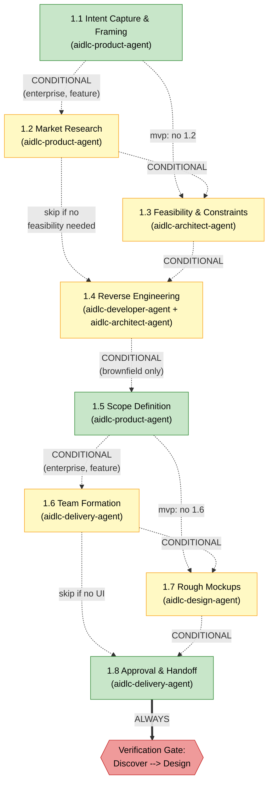

---

## 3. Design Flow

The Design phase discovers team practices, elicits requirements, produces user stories and mockups, designs the application architecture, decomposes the work into Units, plans delivery, and designs each Unit's functional, NFR and infrastructure details. Practices Discovery (2.1) runs as a subagent hub-and-spoke. Delivery Planning (2.8) writes the Design → Build check, and the per-Unit stages (2.9–2.12) repeat for each Unit. The brownfield code scan, Reverse Engineering (1.4), runs earlier in the Discover phase as a pipeline (section 2).

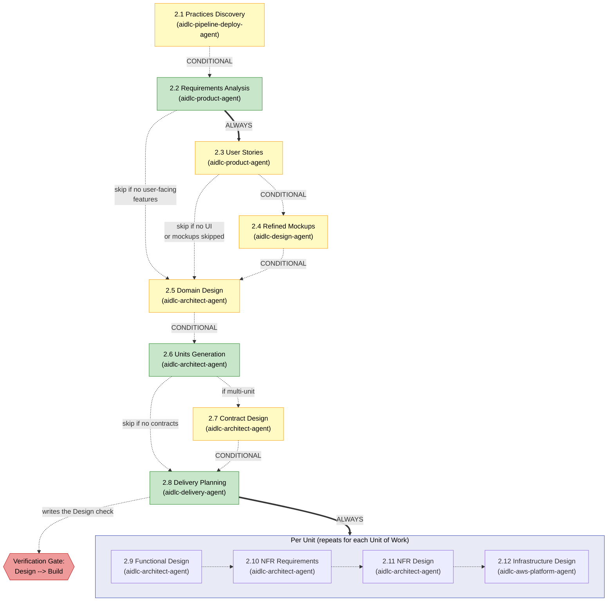

---

## 4. Unit Walk Flow

The following diagram shows the default for a **new source-producing solo Unit
workflow**: unit-major, serial execution with verified checkpoints. The first
DAG Unit, when skeleton-on, must form a working integrated slice and pass a real
end-to-end check plus human approval before later Units. This is different from
the legacy first-stage review. Design-only, no-Unit, existing, and
team-owned paths retain their recorded policies; an explicit stage-major choice
remains valid. Runtime order comes from `unit-of-work-dependency.md`, while
`bolt-plan.md` is planning content.

Eligible skeleton-off workflows offer **Continue automatically** / **Review each
checkpoint** at the start of the Unit walk; skeleton-on offers it after the real skeleton
checkpoint, unless a choice already exists. This approval preference does not
choose swarm execution. Plan Approval and enabled summary confirmation remain
human stops; summary confirmation applies only when
`directive.ceremony.summary_confirmation === "on"`. Build and Test (4.1) and optional
CI Pipeline (6.1) run once across the result.

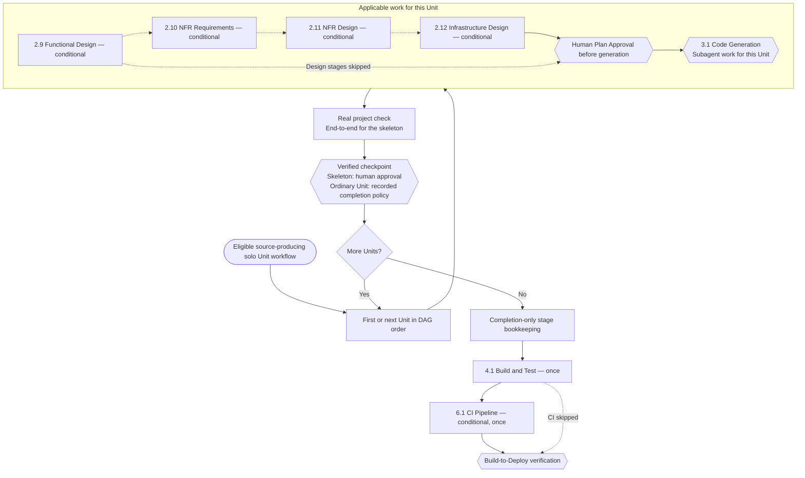

<!-- Text fallback: For an eligible new solo workflow, complete each Unit's applicable design and Code Generation stages in DAG order, preserving human Plan Approval and any enabled summary confirmation. Verify the working result and approve its checkpoint: always human for the skeleton, according to recorded policy for ordinary Units. After all Units, settle bookkeeping and run Build and Test plus optional CI Pipeline. Other workflow paths retain their existing policy. -->

---

## 5. Deploy and Operate Flow

The Deploy and Operate phases cover the deployment pipeline, environment provisioning, deployment execution, observability setup, incident response, and feedback optimization. CI Pipeline (6.1) is the first Deploy stage and appears in the Unit walk flow (section 4). Every Deploy stage is CONDITIONAL. All three Operate stages are CONDITIONAL (bugfix, classic, mvp, poc, refactor and security-patch run none of them). All stages run inline. Feedback Optimization is the last stage; upon approval, the workflow is complete.

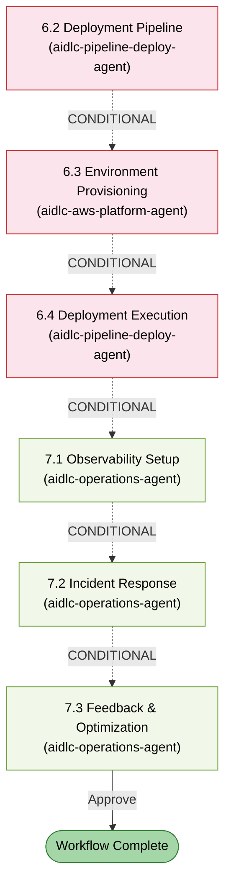

---

## 6. Agent Collaboration Map

The full 14-agent roster comprises 11 domain agents, 2 review-only agents, and
the adaptive-workflows composer. This diagram intentionally covers the 11
domain agents and their primary artifact flows. The review-only agents perform
independent product and architecture checks, while the composer proposes and
reshapes adaptive stage plans; see the [Agent Reference](agents/README.md) and
[Reviewer Invocation](04-stage-protocol.md#reviewer-invocation).

The conductor (SKILL.md) performs each agent invocation as the engine directs;
agents never invoke each other directly. Information flows between agents
through artifacts stored in the intent's record dir
(`aidlc/spaces/<space>/intents/<YYMMDD>-<label>/`). The diagram culminates in
the feedback loop from aidlc-operations-agent back to aidlc-product-agent.

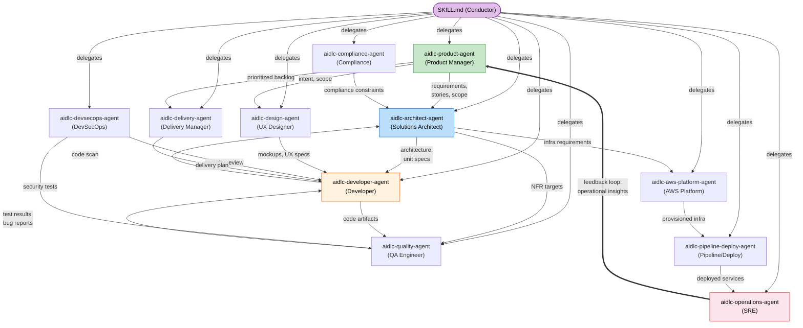

---

## 7. Execution Model

This implementation uses four active execution modes for stages. **Inline** stages execute directly within the orchestrator conversation (user can interact). **Subagent** stages delegate to a single agent through the harness's subagent tool (the Task tool on Claude Code), hub-and-spoke when the stage declares support agents. **Pipeline** stages chain agents sequentially, each link advancing the work product (Reverse Engineering is the shipped example). **Mob** stages convene the support agents in bounded rounds, each contribution blind to the others (in parallel where the harness can dispatch several at once, one after another where it cannot); User Stories is the shipped example.

```mermaid
flowchart LR
    subgraph INLINE["Mode 1: Inline"]
        direction TB
        IN1["Orchestrator reads\nstage file"]
        IN2["Load agent persona\n+ knowledge"]
        IN3["Execute stage steps\ndirectly in conversation"]
        IN4["User interaction\navailable"]
        IN5["Approval gate\n(AskUserQuestion)"]
        IN1 --> IN2 --> IN3 --> IN4 --> IN5
    end

    subgraph SUBAGENT["Mode 2: Subagent (simple)"]
        direction TB
        SA1["Orchestrator reads\nstage file"]
        SA2["Prepare context:\nartifacts + persona"]
        SA3["Task tool call\n(subagent_type specified)"]
        SA4["Subagent executes\n(no user interaction)"]
        SA5["Return structured\nsummary to orchestrator"]
        SA6["Orchestrator presents\ncompletion + approval"]
        SA1 --> SA2 --> SA3 --> SA4 --> SA5 --> SA6
    end

    subgraph TWOSTEP["Mode 3: Pipeline (2-link RE chain)"]
        direction TB
        TS1["Orchestrator reads\nRE stage file"]
        TS2["Task: aidlc-developer-agent\ncode scan"]
        TS3["Developer returns\nscan results"]
        TS4["Task: aidlc-architect-agent\nsynthesis"]
        TS5["Architect produces\n9 artifacts"]
        TS6["Orchestrator presents\ncompletion + approval"]
        TS1 --> TS2 --> TS3 --> TS4 --> TS5 --> TS6
    end

    subgraph MOB["Mode 4: Mob (parallel rounds)"]
        direction TB
        MB1["Orchestrator reads\nstage file"]
        MB2["Lead drafts the\nartifacts inline"]
        MB3["Parallel Tasks: all\nsupport agents, blind"]
        MB4["Each writes its\ncontribution file"]
        MB5["Lead integrates;\nobjection triage\n(judgment -> human,\nknowledge -> round 2)"]
        MB6["Orchestrator presents\ncompletion + approval"]
        MB1 --> MB2 --> MB3 --> MB4 --> MB5 --> MB6
    end

    style INLINE fill:#e8f5e9,stroke:#4caf50,color:#000
    style SUBAGENT fill:#e3f2fd,stroke:#2196f3,color:#000
    style TWOSTEP fill:#fff3e0,stroke:#ff9800,color:#000
    style MOB fill:#f3e5f5,stroke:#9c27b0,color:#000
```

---

## 8. Session Resume Flow

When the user invokes `/aidlc`, the orchestrator checks for an active intent's `aidlc-state.md`. If found, it carries on from the checkpoint (the first call is `next --resume`), and the person can ask to redo, jump to a stage, or start fresh at any time. If not found, it creates the first intent.

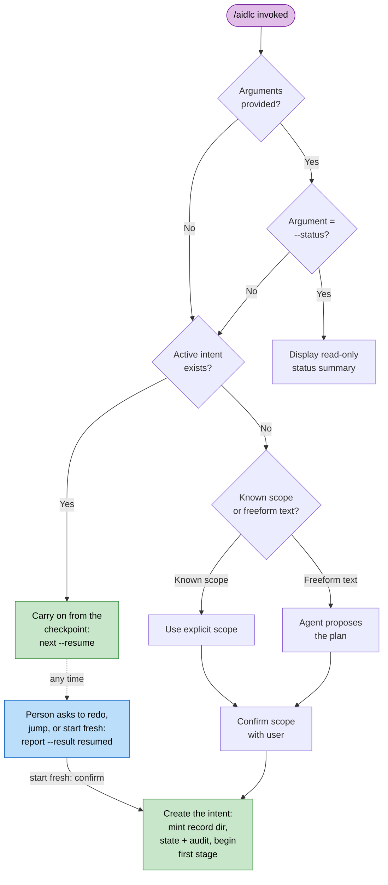

---

## 9. Scope Routing

> Scope routing table: see [Orchestrator Reference -- Scope Mapping](03-orchestrator.md#scope-to-stage-mapping).

---

## 10. Knowledge Loading Order

Each stage loads knowledge in a strict 6-step order. This ensures guardrails take precedence, followed by shared methodology, then agent-specific knowledge, then team customizations, and finally prior stage artifacts. The sequence diagram below shows the loading order for any stage activation.

> **Note:** Steps 1-5 are agent knowledge loading defined by `stage-protocol.md` Section 5; Step 6 (prior stage artifacts) is context added by the orchestrator at runtime, not a file-loading step. On inline stages and for the inline lead of a mob, the step carries the lead's persona itself (`lead_persona`), and `inline_context_paths` lists the team knowledge (steps 4-5) right after the support personas and before the shared and agent methodology (steps 2-3), and the size cap trims methodology first; dispatched agents load in the order below.

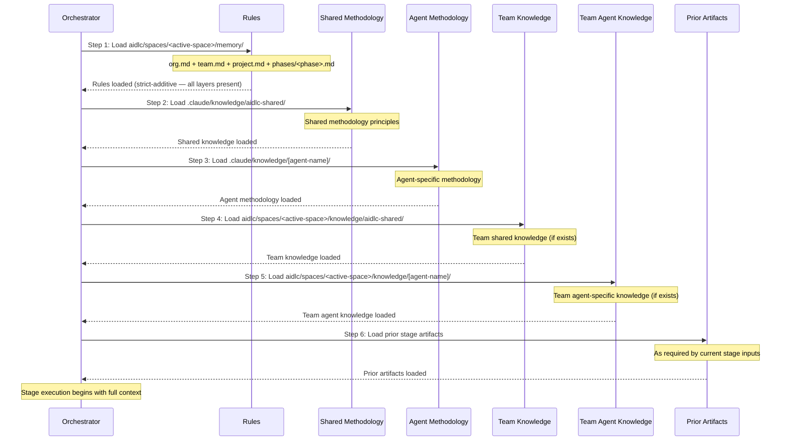

---

## 11. Approval Gate Flow

Every stage (except the 3 Initialization stages) ends with an approval gate. The gate's audit trail is report-owned: `report --result awaiting-approval` records the held gate (`STAGE_AWAITING_APPROVAL`) before the question is presented, and `report --result approved|rejected` records the response verbatim (`GATE_APPROVED`/`GATE_REJECTED`) — never `aidlc-log.ts decision`/`answer`. After 3 revision cycles, an "Accept as-is" escape hatch becomes available. Discover and Design stages may also include a conditional third option to add a previously skipped stage.

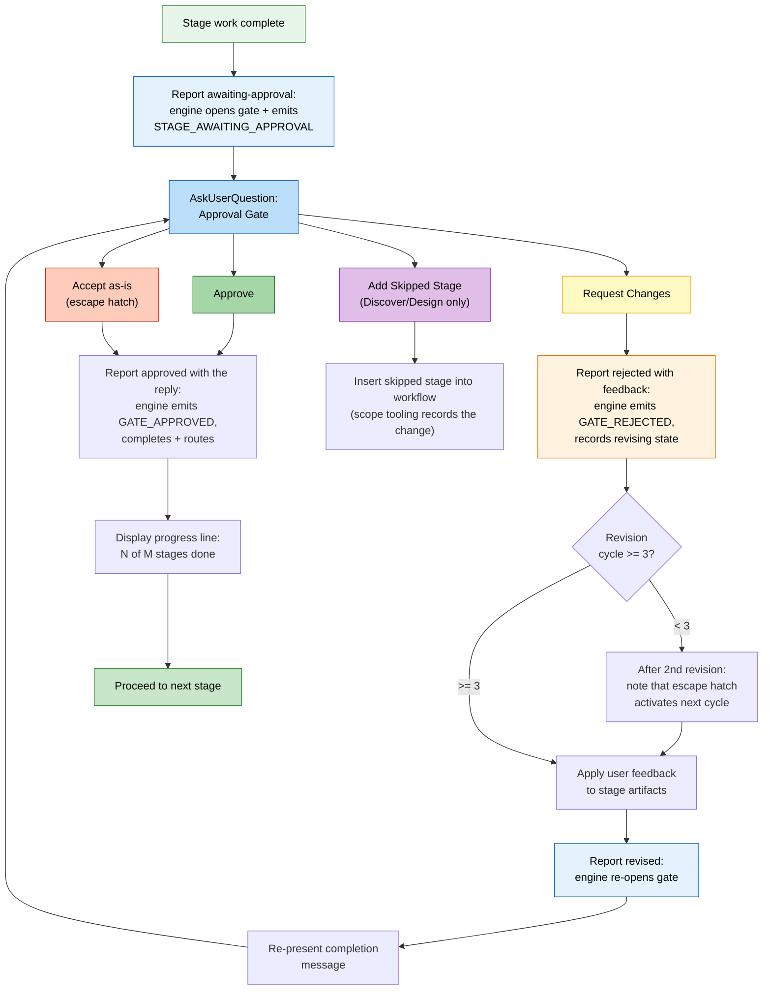

---

## 12. State Tracking

The `aidlc-state.md` file tracks each stage with checkbox notation: `[ ]` (not
started), `[-]` (in progress), `[?]` (awaiting approval), `[R]` (revising),
`[x]` (completed), and `[S]` (skipped). The engine owns these transitions;
conductors report outcomes rather than editing checkbox state. The diagram also
shows the side flows for skip, redo, and jump operations.

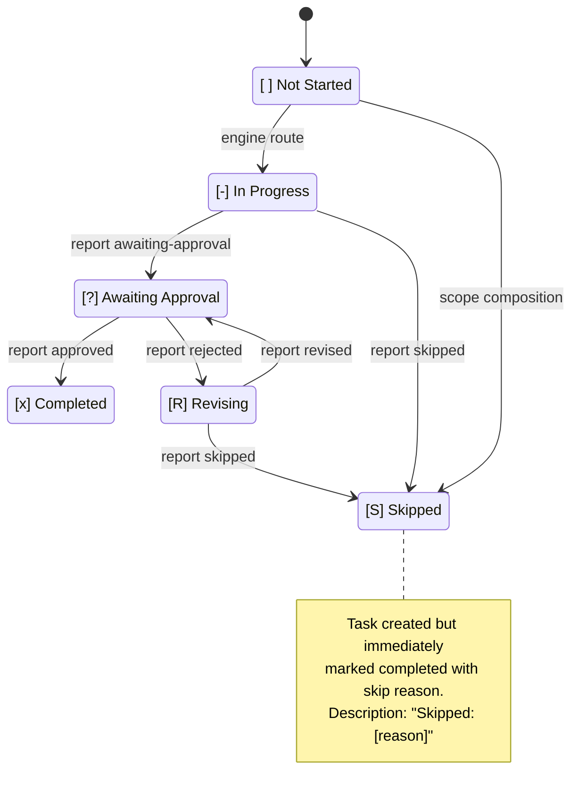

```mermaid
flowchart TD
    subgraph NORMAL["Normal Flow"]
        direction LR
        NS1["[ ] Not Started"]
        IP1["[-] In Progress"]
        AW1["[?] Awaiting Approval"]
        CO1["[x] Completed"]
        NS1 -->|"engine route"| IP1
        IP1 -->|"report gate open"| AW1
        AW1 -->|"report approved"| CO1
    end

    subgraph SKIP["Skip Flow"]
        direction LR
        NS2["[ ] Not Started"]
        SK2["[S] Skipped"]
        NS2 -->|"scope composition"| SK2
    end

    subgraph REDO["Redo Flow"]
        direction LR
        CO3["[x] Completed\nor [-] In Progress"]
        NS3["[ ] Not Started"]
        IP3["[-] In Progress"]
        CO3 -->|"user requests redo\n(state reset, files kept)"| NS3
        NS3 -->|"re-execute stage"| IP3
    end

    subgraph JUMP["Jump Flow"]
        direction LR
        IP4["[-] In Progress\n(stage A)"]
        NS4["[ ] Not Started\n(stage B)"]
        IP4B["[-] In Progress\n(stage B)"]
        IP4 -->|"user requests jump\n(warn about skipped stages)"| NS4
        NS4 -->|"begin target stage"| IP4B
    end

    style NORMAL fill:#e8f5e9,stroke:#4caf50,color:#000
    style SKIP fill:#fff9c4,stroke:#f9a825,color:#000
    style REDO fill:#e3f2fd,stroke:#2196f3,color:#000
    style JUMP fill:#fce4ec,stroke:#e91e63,color:#000
```

---

## Summary of Execution Modes by Stage

This reference table maps every stage to its execution mode and lead agent for quick lookup.

| Stage | Name | Mode | Lead Agent |
|-------|------|------|------------|
| 0.1 | Workspace Scaffold | inline (auto-proceed) | orchestrator |
| 0.2 | Workspace Detection | inline (auto-proceed, deterministic scanner) | orchestrator |
| 0.3 | State Initialization | inline (auto-proceed) | orchestrator |
| 1.1 | Intent Capture & Framing | inline | aidlc-product-agent |
| 1.2 | Market Research | inline | aidlc-product-agent |
| 1.3 | Feasibility & Constraints | inline | aidlc-architect-agent |
| 1.4 | Reverse Engineering | pipeline (2-link) | aidlc-developer-agent + aidlc-architect-agent |
| 1.5 | Scope Definition | inline | aidlc-product-agent |
| 1.6 | Team Formation | inline | aidlc-delivery-agent |
| 1.7 | Rough Mockups | inline | aidlc-design-agent |
| 1.8 | Approval & Handoff | inline | aidlc-delivery-agent |
| 2.1 | Practices Discovery | subagent | aidlc-pipeline-deploy-agent |
| 2.2 | Requirements Analysis | inline | aidlc-product-agent |
| 2.3 | User Stories | mob | aidlc-product-agent |
| 2.4 | Refined Mockups | inline | aidlc-design-agent |
| 2.5 | Domain Design | inline | aidlc-architect-agent |
| 2.6 | Units Generation | inline | aidlc-architect-agent |
| 2.7 | Contract Design | inline | aidlc-architect-agent |
| 2.8 | Delivery Planning | inline | aidlc-delivery-agent |
| 2.9 | Functional Design | inline | aidlc-architect-agent |
| 2.10 | NFR Requirements | inline | aidlc-architect-agent |
| 2.11 | NFR Design | inline | aidlc-architect-agent |
| 2.12 | Infrastructure Design | inline | aidlc-aws-platform-agent |
| 3.1 | Code Generation | subagent (aidlc-developer-agent) | aidlc-developer-agent |
| 4.1 | Build and Test | inline | aidlc-quality-agent |
| 4.2 | Performance Validation | inline | aidlc-quality-agent |
| 5.1 | Code Review | inline | aidlc-quality-agent |
| 5.2 | Security Review | inline | aidlc-devsecops-agent |
| 5.3 | Conformance Review | inline | aidlc-compliance-agent |
| 6.1 | CI Pipeline | inline | aidlc-pipeline-deploy-agent |
| 6.2 | Deployment Pipeline | inline | aidlc-pipeline-deploy-agent |
| 6.3 | Environment Provisioning | inline | aidlc-aws-platform-agent |
| 6.4 | Deployment Execution | inline | aidlc-pipeline-deploy-agent |
| 7.1 | Observability Setup | inline | aidlc-operations-agent |
| 7.2 | Incident Response | inline | aidlc-operations-agent |
| 7.3 | Feedback & Optimization | inline | aidlc-operations-agent |
